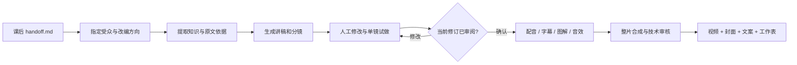
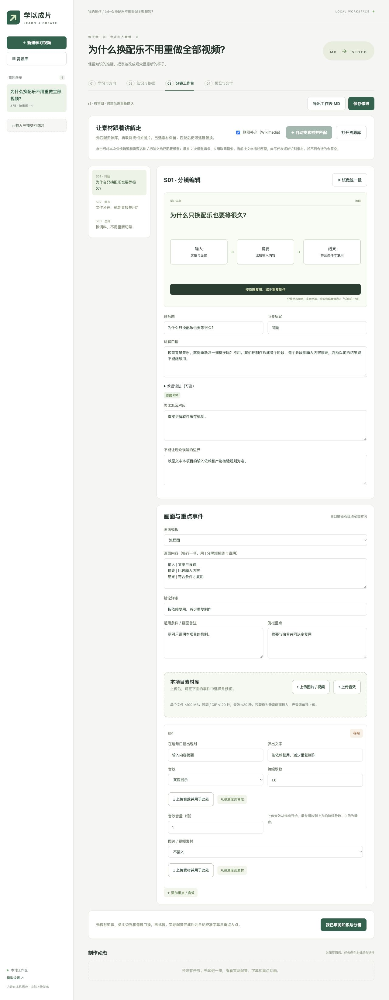
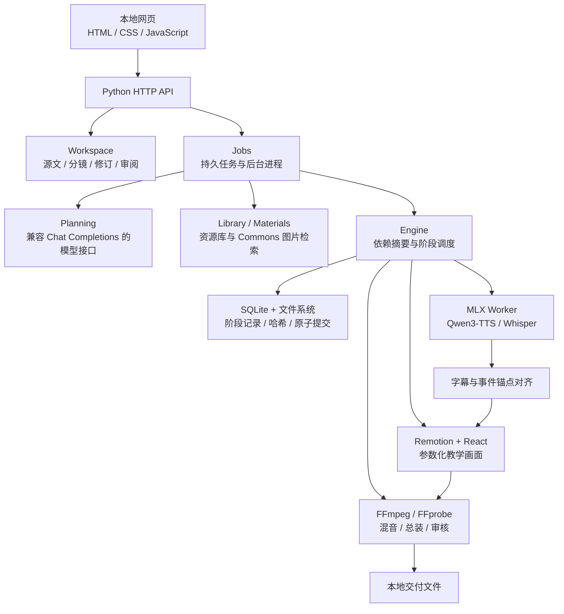

<div align="center">


# 学以成片 · 短视频教学 Agent

**从学习笔记到教学视频，让每一次学习都有可分享的产出。**

[](pyproject.toml)
[](renderer/package.json)
[](renderer/package.json)
[](video_agent/__init__.py)
[](#快速开始)

[项目介绍](#为什么做这个项目) · [功能一览](#已经可以做什么) · [系统架构](#系统架构) · [技术栈](#技术栈) · [快速开始](#快速开始) · [开发路线](#开发路线)

</div>

## 为什么做这个项目

每天学完一节课，往往只留下笔记。要把它做成能发布的教学视频，还需要重新梳理知识、选择适合观众的例子、写讲稿、配音、找素材、做字幕和封面。修改一句讲稿后，重复制作也很耗时。

**学以成片**来自一条持续使用的学习创作流程：课后整理 `handoff.md`，指定受众与讲解方向，让模型把知识转成讲稿和分镜，再通过可恢复的本地执行链生成视频。

项目已用于 Transformer 基础课程、Tokenizer 和 TAGNet 论文分享等实际内容制作。公开仓库提供通用代码与原创文字示例；个人课程、参考声音、直播片段、音乐、模型权重和历史成片留在使用者本机。

当前是 **0.2.0 本地工作台版本**：以受约束的模型规划、人工审阅和确定性的制作工具组成工作流。它没有接入 LangGraph、LangChain 或 MCP，也没有声称模型可以不经审阅自主完成所有创作决策。

## 文档导航

| 文档 | 解决什么问题 |
| --- | --- |
| [安装与配置](docs/public/SETUP.md) | 如何启动网页、接模型、配置完整媒体环境 |
| [架构与执行机制](docs/public/ARCHITECTURE.md) | 模块职责、项目协议、缓存、任务恢复与音画链路 |
| [测试与验证边界](docs/public/TESTING.md) | 哪些测试可直接运行，哪些需要本地模型和素材 |
| [来源与使用说明](docs/public/THIRD_PARTY.md) | 第三方组件、模型、素材及许可边界 |
| [原创学习交接示例](examples/handoff.md) | 给 Agent 的学习笔记可以怎么写 |
| [示例分镜数据](examples/storyboard.json) | 讲稿、知识引用、类比边界与事件如何表达 |

## 已经可以做什么

| 环节 | 已实现能力 | 当前边界 |
| --- | --- | --- |
| 学习导入 | 导入 Markdown；保存原文快照、创作方向、受众与目标时长 | 不自动读取其他产品的私人学习聊天 |
| 知识提取 | 模型选择原文行号；程序回填逐字引文，校验知识与来源 | 引用存在不代表模型推理一定正确 |
| 教学改编 | 按受众生成口播、画面、类比映射与边界、发布文案 | 仍需人工检查知识和类比 |
| 分镜工作台 | 逐镜修改口播、图解、术语读法、弹字与音效；单镜试做 | 不是自由多轨剪辑器 |
| 配音与字幕 | 本地 Qwen3-TTS 参考声音合成；Whisper 转写、中文字幕和事件对齐 | 需要自行提供有权使用的声音；暂未实现英文字幕 |
| 素材与资源库 | 上传图片、视频、GIF、音效；分类、标签、预览和跨项目复用 | 语音分类暂不等于网页切换合成音色 |
| 自动素材匹配 | 优先从本地库匹配；缺少时检索 Wikimedia Commons 图片并放入分镜事件 | 按文字元数据匹配，尚无视觉语义检索或抖音切片搜索 |
| 声音控制 | 语速、人声音量、背景音乐音量、事件音效音量 | 人声与片头原声独立；需要试做后判断听感 |
| 生成与交付 | 分镜渲染、整片总装、独立播放器、中文字幕、MD 工作表、审核记录 | 主视频目前为 16:9 教学布局 |
| 封面 | 一次生成 **4:3 横封面 + 3:4 竖封面**，独立排版、预览与下载 | 不把竖版直接裁成横版；也保留单张输出 |
| 可靠执行 | 持久任务、修订历史、缓存核验、失败重试、增量制作 | 本机进程队列，不是分布式任务系统 |

### 一条实际创作链路



受众、类比方向、讲稿、素材、片头与声音是项目配置。CS 场景是项目起点的一种使用方式，不是渲染器必须依赖的主题。

### 工作台预览

<details>
<summary>查看实际工作台截图（原创三镜文字示例，无私人素材）</summary>



</details>

## 系统架构



主应用使用 Python 标准库组织服务与执行。文字模型通过用户配置的 API 调用；语音和转写在独立的本地 MLX 环境执行，渲染由 Node / Remotion 完成。各层通过 JSON 和本地文件衔接。

## 技术栈

| 层级 | 技术 | 在项目中的用途 | 主要代码 |
| --- | --- | --- | --- |
| 应用与服务 | Python 3.11+、`ThreadingHTTPServer`、`argparse` | 本地 API、CLI、任务入口；核心应用无第三方 Python 运行依赖 | [web.py](video_agent/web.py)、[cli.py](video_agent/cli.py) |
| 网页交互 | 原生 JavaScript、HTML、CSS | 分镜编辑、资源上传、进度轮询、播放器、封面操作 | [web/](web/) |
| 模型规划 | `urllib`、Chat Completions 兼容 API、JSON 结构校验 | 知识提取、受众改编、有限次数修正与实际用量记录 | [planning.py](video_agent/planning.py) |
| 本地语音 | MLX Audio、MLX、Qwen3-TTS | 参考声音条件合成、分句生成、有限重试、边缘平滑 | [mlx_tool.py](workers/mlx_tool.py) |
| 语音转写 | Whisper large-v3-turbo（MLX） | 字词时间戳、口播覆盖和末句检查、字幕时间基准 | [alignment.py](video_agent/alignment.py) |
| 术语控制 | 读法映射、字符对齐 | 改变 TTS 读法，同时保留原文字幕与画面术语 | [pronunciation.py](video_agent/pronunciation.py) |
| 教学画面 | Remotion **4.0.537**、React / React DOM **19.3.1**、TSX | 流程、旁路、计算、论文图片四种模板和重点弹字 | [renderer/](renderer/) |
| 浏览器渲染 | Chrome Headless Shell、Remotion renderer / bundler | 帧级画面渲染；本机使用 `swangle` 图形模式 | [render.mjs](renderer/render.mjs) |
| 音视频处理 | FFmpeg、FFprobe | 变速、响度与混音、PCM 中间片、整片编码、解码和元信息核验 | [media.py](video_agent/media.py) |
| 数值与同步 | NumPy、SoundFile | 音频采样处理、相关性同步检测 | [check_sync.py](workers/check_sync.py) |
| 持久执行 | SQLite3、JSON、`fcntl`、独立进程 | 阶段状态、锁、输入快照、失败记录与修订冲突保护 | [state.py](video_agent/state.py)、[jobs.py](video_agent/jobs.py) |
| 缓存与完整性 | SHA-256、规范化输入摘要、原子目录提交 | 验证可复用结果；避免只凭“文件存在”复用损坏缓存 | [state.py](video_agent/state.py)、[util.py](video_agent/util.py) |
| 素材服务 | Wikimedia Commons MediaWiki API | 图片候选查询、来源与许可记录、下载校验与事件绑定 | [materials.py](video_agent/materials.py) |
| 验证 | Python `unittest`、GitHub Actions | 便携核心测试；本机完整环境下另做媒体回归与实际产物审核 | [测试说明](docs/public/TESTING.md) |

本地已使用的语音环境为 **MLX Audio 0.6.0 / MLX 0.32.4**，模型为 Qwen3-TTS 12Hz 0.6B Base 8-bit 与 Whisper large-v3-turbo ASR fp16。它们不属于主 Python 包依赖，也不会随仓库分发。媒体环境迁移仍需要配置，尚未提供一键安装器或跨平台保证。

## 关键工程设计

### 1. 把来源、改编和画面分开

知识层保存 `K01` 等编号与原文引文；分镜层用 `knowledge_ids` 引用知识，并记录类比映射及边界。模型产生的任意文件路径、导入音频和随机种子不会直接进入执行配置。素材通过受控登记后使用。

提取与改编各允许一次结构修正，单次完整改编最多四次模型请求。缓存绑定输入和提示词版本；记录成功与失败时能取得的实际用量，不把失败请求当作免费。

### 2. 修改一处，不把所有结果推倒重做

| 修改 | 可以复用 | 需要更新 |
| --- | --- | --- |
| 某镜口播 | 其他镜头有效结果 | 该镜配音、转写、对齐及相关制作阶段，再总装审核 |
| 某镜图解 | 已有有效配音与转写 | 对应画面和相关下游产物 |
| 背景音乐或音量 | 已有有效配音与画面 | 相关导出与审核 |
| 人声音量 | 已有有效合成、转写与画面 | 音频混合、总装与审核 |
| 损坏某阶段产物 | 不受影响的有效阶段 | 损坏阶段及相关下游 |

缓存会检查输入摘要和产物 SHA-256。阶段成功后才原子登记结果；失败留下错误与可复用的成功阶段。模型身份用配置及权重清单参与指纹，不会每次重新读取全部大型权重文件。

### 3. 让画面切换和声音共享时间基准

各镜头先使用 PCM 音频中间产物，再统一编码最终 AAC，减少分段 AAC 拼接时填充造成的累计偏移。字幕与弹字由真实 ASR 时间戳和口播锚点确定，不直接使用模型预估秒数。

转写覆盖、末尾漏读、数值与重复等门禁用于拦截部分异常；音轨同步采用采样相关性核验。自动通过仍不能代替人对语气、音色、知识准确性和整体节奏的判断。

### 4. 长任务与编辑状态可追溯

网页任务保存输入修订和制作设置，关闭页面后后台仍可继续。修改内容会取消原修订的审阅状态；过期页面的提交不能覆盖更新版本。封面有独立修订，不要求为换封面重做视频。

## 快速开始

### 先体验文字工作台

需要 Python **3.11+**。以下命令在仓库根目录运行：

```bash
git clone https://github.com/15016623369a-spe/xue-yi-cheng-pian-agent.git
cd xue-yi-cheng-pian-agent
python3 -m video_agent web --port 8765
```

打开 [本地工作台（127.0.0.1:8765）](http://127.0.0.1:8765)。macOS 也可双击 `启动工作台.command`。

- 点击「载入三镜交互练习」可打开仓库自带的原创文字分镜，不调用模型、不包含个人素材。
- 点击「新建学习视频」，导入 [examples/handoff.md](examples/handoff.md) 或自己的 Markdown。
- 在「模型设置」填写自己的 API 地址、模型名与密钥，再触发知识提取和改编。

**启动网页和查看文字示例不需要下载语音模型。实际改编需要模型 API；保存并校验分镜、单镜试做和视频导出还需要完整本地媒体配置及参考声音。**

### 完整视频制作环境

当前实际验证平台为 **macOS / Apple Silicon**。完整制作需要：

1. FFmpeg / FFprobe、Node.js、Remotion 依赖和可用的 Chrome Headless Shell。
2. 独立 MLX Python 环境，以及本地 Qwen3-TTS / Whisper 模型。
3. `config/local.json` 指向上述工具和模型；参考 [config/local.example.json](config/local.example.json)。
4. 自己的参考音频及对应文本；复制 [config/voice.example.json](config/voice.example.json) 为 `config/default-voice.json` 并填写**绝对路径**。

完整配置与检查方法见 **[安装与配置](docs/public/SETUP.md)**。项目不会自动下载权重，也不会把作者电脑上的路径当成通用安装配置。

```bash
# 检查工具路径；不等于执行完整渲染验收
python3 -m video_agent doctor

# 运行不依赖私人素材、模型或付费接口的核心测试
python3 scripts/test_portable.py
```

## 项目结构

```text
video_agent/          Python 服务、规划、执行、资源库、对齐与状态管理
web/                  原生网页工作台与独立播放器
renderer/             Remotion / React 参数化画面与封面
workers/              独立本地 MLX 合成、ASR 与同步检测
config/               可公开的配置模板；本机配置被 Git 忽略
examples/             原创 handoff 与三镜文字分镜
scripts/              启动、环境连接、测试与本地验收工具
tests/                核心回归与依赖本地环境的集成测试
docs/public/          面向使用者和开发者的公开文档
.github/workflows/    无模型、无密钥的便携测试流程
```

运行后，用户项目位于 `projects/`，资源位于 `assets/`，本地服务与模型设置位于 `.web/`。每个项目的 `.agent/` 保存阶段状态和缓存，`outputs/` 保存交付结果。以上运行数据均不提交到 Git。

## 测试与验证

仓库提供不依赖私人素材的便携测试入口和 GitHub Actions 流程，覆盖输入摘要缓存、损坏恢复、引用定位、术语读法、语音文本门禁与公开版导入。

完整媒体链路已在作者本机用于真实课程与论文分享制作；本机的完整测试还依赖私人媒体登记、参考音色和已安装环境，因此不能把本机结果等同于新电脑的开箱验证。详细范围和运行方式见 [测试与验证边界](docs/public/TESTING.md)。

## 开发路线

- [x] 参数化分镜协议、阶段摘要缓存与可恢复执行
- [x] Markdown 导入、模型知识提取与受众改编
- [x] 网页分镜编辑、素材与音效上传、单镜预览、整片交付
- [x] 本地配音、中文字幕、术语读法、声音调节与技术审核
- [x] 分类资源库、本地匹配与 Commons 图片检索
- [x] 横竖封面成对生成、独立播放器与工作表导出
- [ ] 参考视频链接解析、脚本与剪辑节奏分析
- [ ] 更丰富的视频素材检索与视觉语义匹配
- [ ] 中英双语字幕与翻译审阅
- [ ] 多学科质量评估与可配置的风格方案
- [ ] 平台数据导入、留存分析与修改建议
- [ ] 更完整的安装、部署与跨平台适配

这些是后续方向，不属于当前可用功能。发布由用户自行完成，项目没有自动绑定平台账号或自动上传能力。

## 来源与许可

当前独立执行链直接使用 Remotion / FFmpeg 和本地语音工具，**不依赖 MoneyPrinterTurbo 或 NarratoAI**。早期曾评估或调用过这些项目，不代表本仓库继承了它们的完整功能。

第三方组件、模型和素材分别适用各自条款，参见 [来源与使用说明](docs/public/THIRD_PARTY.md)。本仓库暂未指定整体开源许可证；公开展示不自动授予第三方素材、人物声音或商标的使用权。

README 的导航与技术介绍组织方式参考了 [Ragent](https://github.com/15016623369a-spe/ragent)，这里的架构、模块与功能说明均以本项目实际代码为准。
